# 网易云音乐 · DeepSeek Harness 插件

在 DeepSeek Harness 里直接听网易云音乐：左侧栏入口 → 整页音乐界面（每日推荐 / 歌单 / 歌手 / 搜索），
扫码登录后即可播放。音乐面板里有页内播放条；回到对话后，播放器缩到**左侧栏底部的迷你播放器**，
不悬浮、不遮挡输入框，一边工作一边听歌。

仓库：<https://github.com/zeelinkCN/dsh-netease-music>

 

## 功能

- **官方红标**：左侧栏入口、面板左上角、插件管理页统一使用网易云官方红底白音符图标（22px）。
- **全屏播放页（黑胶 / 歌词 严格互斥）**
  - 黑胶模式：整页封面模糊背景 + 正圆黑胶旋转（可点唱片暂停/播放），不显示歌词卡。
  - 歌词模式：全屏大字号滚动歌词，当前行品牌红高亮、自动居中、点任意行跳唱、翻译副行；不显示黑胶。
  - 右上角「黑胶 / 歌词」一键切换并记住偏好；返回或 Esc 退出不中断播放。
- **音质可调**：自动 / 标准 / 较高 / 极高 / 无损 / Hi-Res，切换时保持播放进度；显示实际码率与「试听」标记（会员账号实测无损 FLAC 1.5 Mbps）。
- **播放条不挡工作区**
  - 在网易云面板里：页面底部内嵌一条 dock（占自己的布局行，不遮列表、不悬浮）。
  - 回到对话/其它面板：只在**左侧栏 Settings 上方**显示占满侧栏宽度的迷你播放器（封面 + 歌名 + 上一首/播放/下一首 + 喇叭音量滑杆，2px 进度贴底）；侧栏收起成 56px 时只留封面按钮。
- **扫码登录**：面板内直接出二维码，手机网易云 App 扫一扫；登录态只存在本机，会员账号解锁高音质。
- **三种听歌入口**：推荐（今日推荐 / 推荐歌单 / 收藏歌手）、歌单（我的/收藏，全量曲目）、搜索（单曲/歌单/歌手/专辑）；另有歌单 / 专辑 / 歌手详情页。
- **首次安装即自动装好数据引擎**（cloud-music-mcp）：无需命令行，面板内可视化进度与日志。

## 数据来源

数据来自你的网易云 MCP：[Code-MonkeyZhang/cloud-music-mcp](https://github.com/Code-MonkeyZhang/cloud-music-mcp)。

插件把它的 Python 依赖（`pyncm` + 账号登录态）作为**数据引擎**常驻运行（`server/bridge.py`），
因为 MCP 的 `tools` 只返回给人/模型看的文本（没有封面、时长、歌词等结构化字段），
而界面需要结构化数据与可播放音源。登录态与 MCP 共享：扫码登录后会把 cookie 镜像写入
`engine/cloud-music-mcp/src/cloud_music_mcp/storage/cookies.json`，所以同一个 MCP 也对 Agent 生效。

> 想把 MCP 的工具也暴露给 DeepSeek 的 Agent（例如「帮我放首歌」），在
> `~/.dsh/profiles/<你的 profile>/cordis.patch.yml` 追加一行（见文末「可选：把 MCP 也给 Agent 用」）。

## 目录结构

```
dsh-netease-music/
├── index.js              # Host：REST 路由、engine 进程管理、音频/图片代理、缓存
├── client.js             # 浏览器：main 面板 + sidebar 图标 + shell.overlay 播放条
├── server/bridge.py      # 常驻 Python 数据引擎（NDJSON over stdio）
├── engine/cloud-music-mcp/   # 上游 MCP 仓库 + .venv
├── docs/                 # CONTRACT.md 契约 + 验收截图
├── locale/{zh,en}.json   # 插件管理页展示文案
└── assets/icon*.png      # 官方网易云红标（插件管理页图标）
```

## 安装

**不需要任何命令行操作。** 在 DeepSeek Harness 里用 `plugin_manager` 的 `install_bundle` 指向这个包目录即可：

1. 首次激活时，插件会自动检测数据引擎并**自动安装**：
   `git clone cloud-music-mcp` → 创建 `.venv` → `uv pip install -e .`（没有 uv 时自动退回 `python3 -m venv` + `pip`）。
   - 过程在面板「数据引擎」卡片里实时显示（阶段 + 日志），也可以调
     `GET /netease-panel/api/setup/install/log` 查看。
   - 安装好后自动连接、自动拉首页，无需重启 Harness。
2. 左侧栏出现网易云图标，点开扫码登录即可听歌。

> 引擎目录默认是 `engine/cloud-music-mcp`（已在 `.gitignore` 中，不进仓库、不随包分发）。
> 想手动预装或装到别处，可用环境变量 `DSH_NETEASE_PYTHON` / `DSH_NETEASE_UV` 覆盖。

### 依赖前置（自动安装所需）

| 依赖 | 用途 | 没有时 |
| --- | --- | --- |
| `uv` | 下载 Python 3.12 并建 venv（推荐） | 自动退回系统 `python3.10+` + `pip` |
| `git` | 克隆上游 MCP 仓库 | 需提前把 cloud-music-mcp 放到 `engine/` |
| 网络/代理 | 拉取 pip 依赖与网易云接口 | 面板显示安装/网络错误，可点「重试」 |

## 使用

1. 点左侧栏「网易云音乐」图标 → 右上角「扫码登录」→ 用手机网易云 App 扫码。
2. 首页「每日推荐」「推荐歌单」「我的歌单」「收藏歌手」任选；或切到「搜索」。
3. 点任意曲目 / 播放全部 → 底部播放条出现，可拖进度、切歌、调音量、开播放队列。
4. 切到对话继续工作，播放条仍在底部；点封面/歌名回到音乐面板。

## 配置

Host 侧支持环境变量（一般不需要）：

| 变量 | 默认 | 说明 |
| --- | --- | --- |
| `DSH_NETEASE_MUSIC_DIR` | `~/.dsh/netease-panel` | 登录态与日志目录 |
| `DSH_NETEASE_PYTHON` | `engine/cloud-music-mcp/.venv/bin/python` | 引擎解释器 |
| `DSH_NETEASE_BRIDGE` | `server/bridge.py` | 引擎脚本 |

## 故障排查

- 面板提示「数据引擎尚未安装」：回到「安装」第 1 步建 venv。
- 扫码后一直 waiting：检查网络（网易云接口在国内网络需要代理时，给引擎加代理环境变量），日志在 `~/.dsh/netease-panel/bridge.log`。
- 某首歌点了没声音：会员/版权限制，`/api/audio` 会返回「这首歌暂时没有可播放的音源」；播放条会跳到下一首。
- 想清空登录态：面板账号菜单「退出登录」，或删除 `~/.dsh/netease-panel/cookies.json`。

## 隐私

- 登录 cookie 仅保存在本机 `~/.dsh/netease-panel/cookies.json`（并镜像给本地 MCP 的 storage 目录）。
- 插件只访问网易云官方接口（经 `pyncm`）与 Harness 本地 `127.0.0.1`，不上传任何账号信息。

## 可选：MCP 也给 Agent 用

`cordis.patch.yml` **默认已包含** `netease-mcp` 一行：它把 `cloud-music-mcp` 作为 stdio MCP 服务器接进 Harness，
于是 Agent 能直接调用 `cloud_music_*` 工具（搜歌、歌单、播放），与面板共享登录态。

如果不希望 Agent 直接操作音乐，删掉 `cordis.patch.yml` 里的 `netease-mcp` 那一项并重启 Harness 即可；
也可以只保留 `command` 的路径指向你机器上的其它 MCP 安装。

## 开发与验证

- 契约：`docs/CONTRACT.md`（数据形状 / 路由 / 播放器 store / 视觉规范 / 测试钩子）。
- 数据引擎自测（真实网络）：`cd dsh-netease-music && node server/selftest.mjs` → 27/27。
- Host 冒烟：`node --check index.js`，用假引擎驱动全部 17 条路由（28 项断言）。
- 真实联调：真实 bridge + 真实网易云音源，14/14 通过；headless Chrome 里 `<audio>` 真实播放 120 万字节 mp3，`currentTime` 前进、`readyState=4`。
- UI 离线验收：`cd netease-panel-selftest && node run.mjs` → **PASS 92 / FAIL 0**（headless Chrome CDP，16 张截图，见 `netease-panel-selftest/shots/`）。
- 侧栏图标：官方网易云红底白色音符标志，128px PNG 内联为 dataURL（`client.js` 的 `ICON_DATA`），深/浅色都保持红色；插件管理页图标为 `assets/icon.png`。

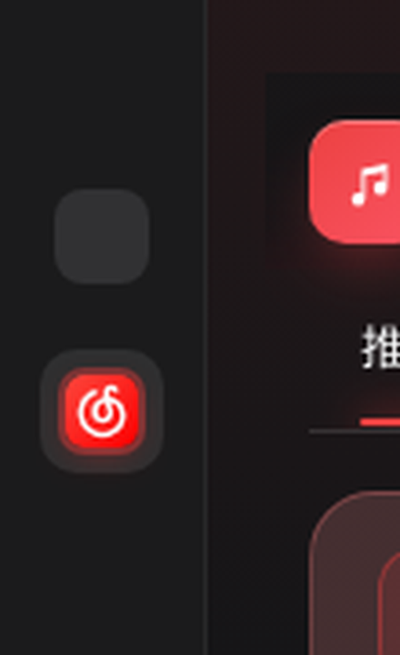
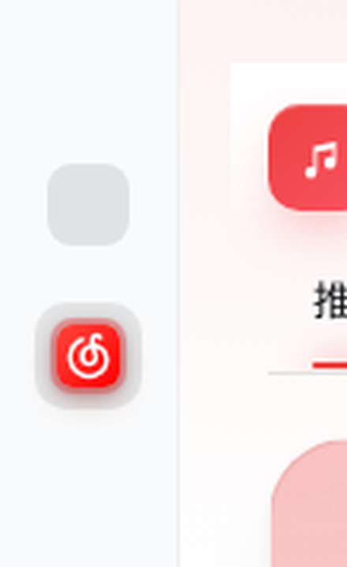
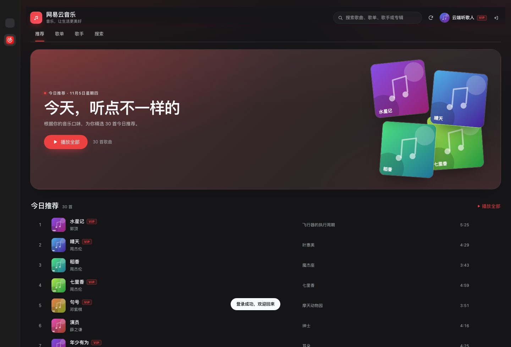
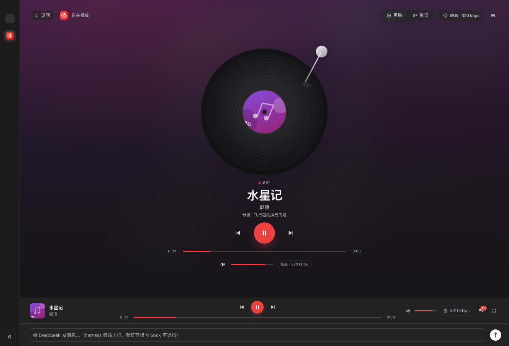
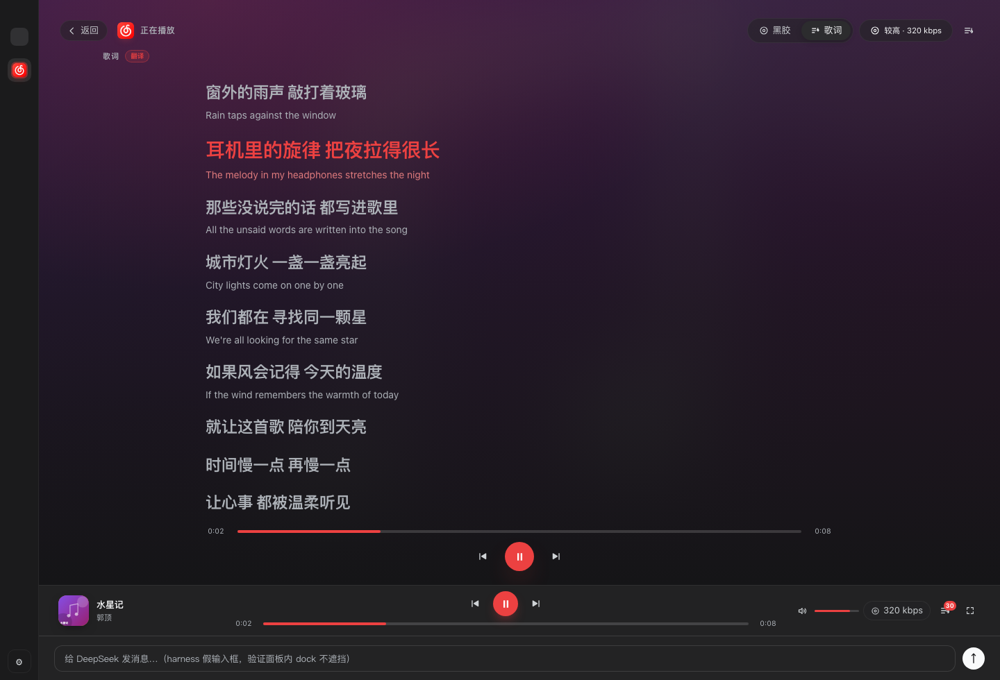
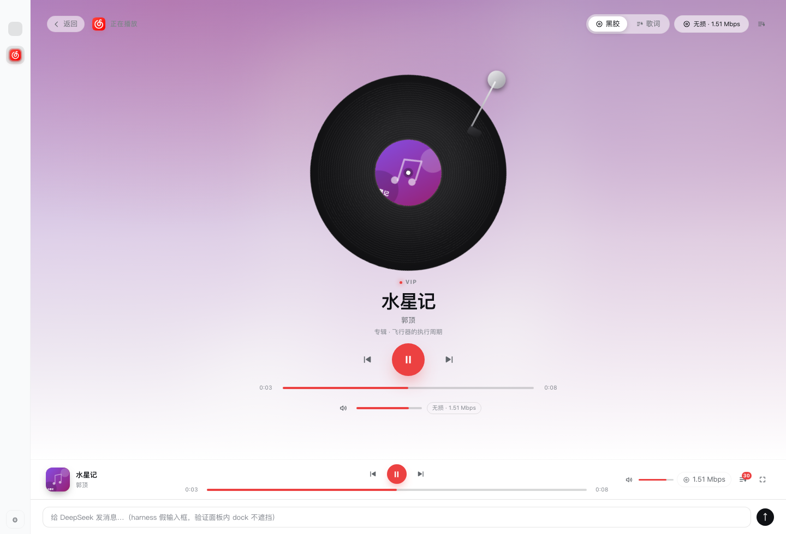
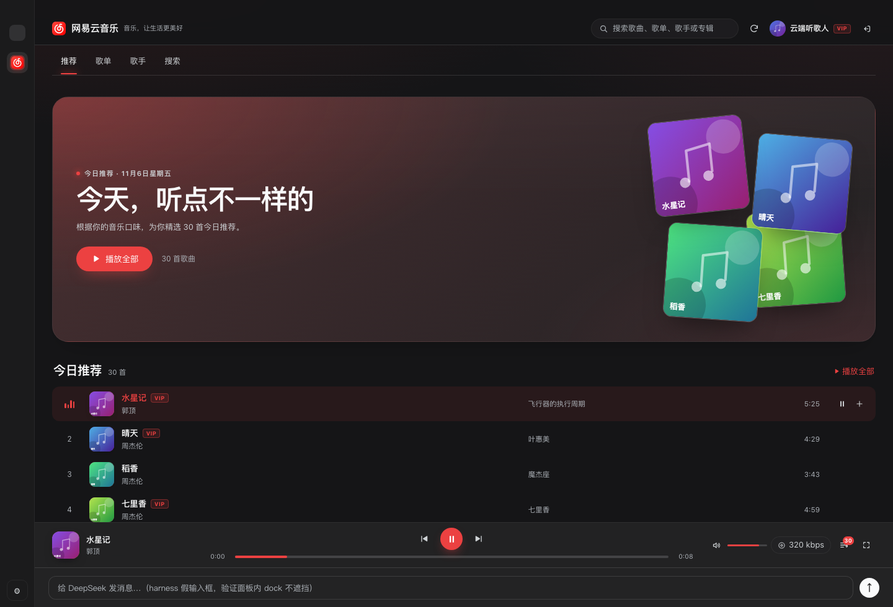
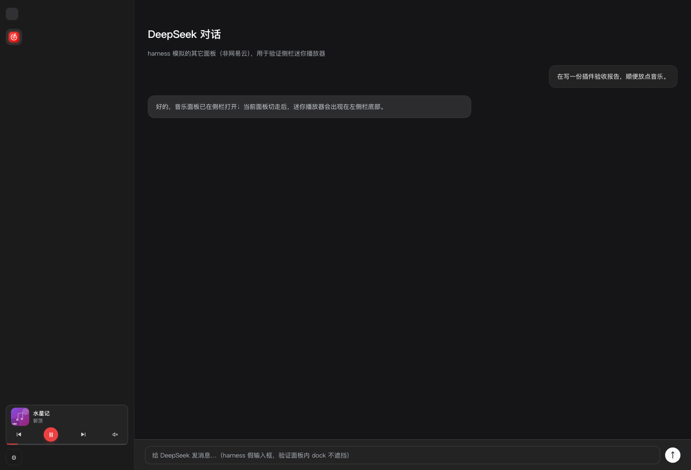
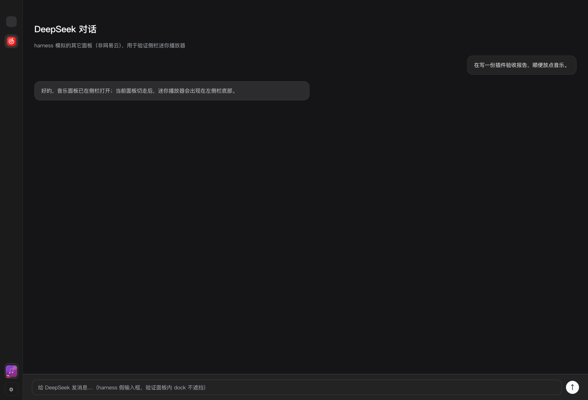
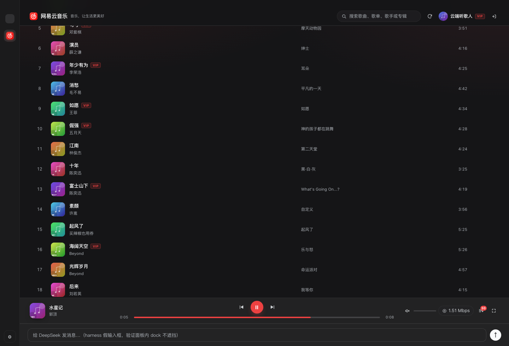
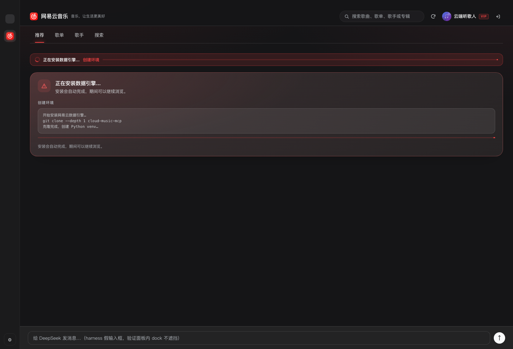

## Windows 支持

插件本身是「浏览器 UI + Node Host + Python 引擎」，同一套代码两个平台通用，已做跨平台处理：

- venv 解释器：macOS/Linux `.venv/bin/python`，Windows `.venv/Scripts/python.exe`（Host 自动判断）。
- 自动安装器：Windows 会找 `uv.exe`（`%USERPROFILE%\.local\bin`、`%LOCALAPPDATA%\Programs\uv`、WinGet Links 等）、用 `where uv`，
  venv 里用 `pip.exe`；没有 uv 时退回系统 `python.exe`（需要 3.10+）。
- 音频/图片代理、REST 路由、播放器逻辑都不依赖平台。
- `cordis.patch.yml` 里 `netease-mcp` 的 `command` 是**绝对路径**，Windows 上改成：
  `...\dsh-netease-music\engine\cloud-music-mcp\.venv\Scripts\cloud-music-mcp.exe`
  （装好引擎后，`GET /netease-panel/api/status` 的 `mcpEntry` 字段会给出本机正确路径；不想要 Agent 工具也可以直接删掉这一行，面板功能不受影响）。

> 说明：本项目在 macOS 上开发和验收；Windows 的布局差异（顶栏 caption 高度通过 `--dsh-frame-top-clearance` 自适应、侧栏 footer 槽位）逻辑上兼容，但尚未在 Windows 真机跑过，首次使用如遇留白/对齐问题请提 issue。

## 已知局限

- 未登录（匿名）状态下，会员歌曲只能试听 128k/约 42 秒；登录自己的会员账号后才是完整音质。
- 离线 harness 用假侧栏（56px）+ 全宽 main，真实 Harness 顶栏下 `--dsh-frame-top-clearance` 的实际留白需真机目视。
- 歌单详情首屏 100 行 + 「加载更多」，未做虚拟滚动。
- 歌词为标准 LRC 同步（非逐字），暂无「歌词/写真」等更多播放页皮肤。
- 迷你播放器依赖 Harness 的 `sidebar.footer.action` 槽；若宿主改版/收起侧栏，位置会随之变化（已同时适配 56px rail）。

